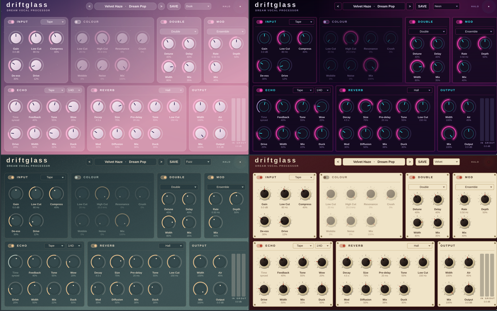

# Driftglass (working name)

A dream pop / shoegaze / synth pop / vintage vocal processor (VST3 + standalone): input conditioning,
lo-fi colour, doubler and octave voices, chorus/ensemble, four echoes and seven reverbs, 70 presets,
five UI themes. See `docs/DESIGN.md` for the signal flow and module list.



## Build

CI (`.github/workflows/build.yml`) builds universal macOS (11+) and Windows x64 VST3 + standalone and runs the engine tests.


```
cmake -B build -DCMAKE_BUILD_TYPE=Release            # fetches JUCE 8.0.4
# or: cmake -B build -DJUCE_DIR=/path/to/JUCE
cmake --build build --config Release
ctest --test-dir build                                # engine tests
```

macOS builds target macOS 11+ universal (Intel + Apple Silicon). No AVX2 or other `-march` flags are used;
the DSP is scalar C++. Windows builds use the static runtime.

Layout: `Source/engine` is plain C++ (parameter table, DSP modules, reverbs, presets) with tests in `tests/`.
`Source/plugin` is the JUCE wrapper, themes and UI. User presets are saved as `.dgpreset` files in
`~/Library/Application Support/Driftglass/Presets` (macOS) or `%APPDATA%\Driftglass\Presets` (Windows).
